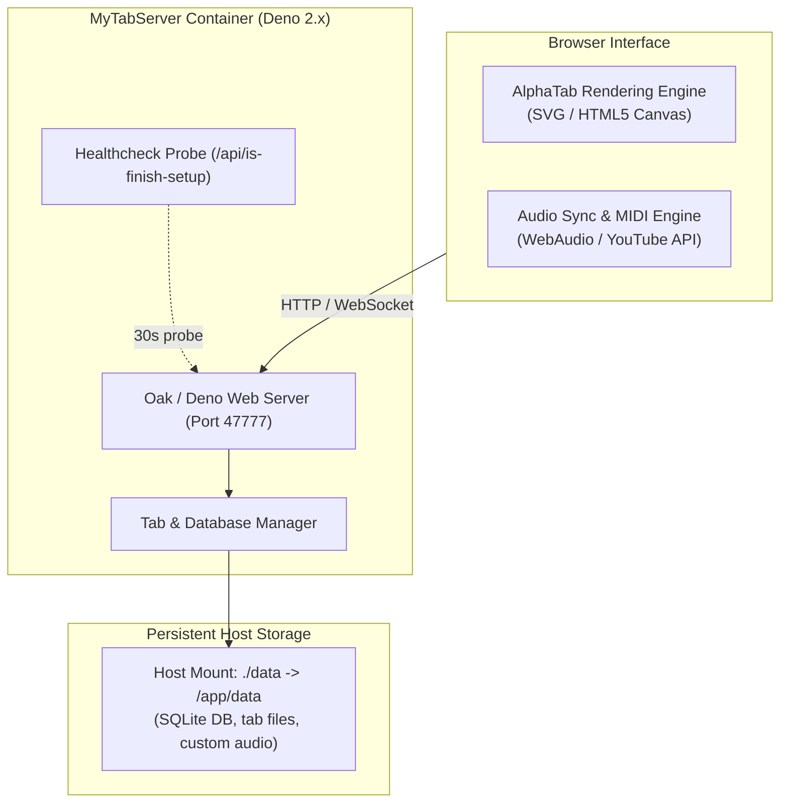

# MyTabServer (Self-Hosted It's MyTabs)

> Self-hosted, web-based guitar and bass tablature player with audio/YouTube synchronization, tailored for containerized Coolify and Docker deployments.

[](https://github.com/louislam/its-mytabs)
[](https://deno.land)
[](https://alphatab.net)
[](Dockerfile)
[](LICENSE)

`mytabserver` is a deployment-optimized distribution of [**It's MyTabs**](https://github.com/louislam/its-mytabs) by [Louis Lam](https://github.com/louislam) (creator of Uptime Kuma). It enables musicians to self-host and organize their private library of Guitar Pro, PowerTab, and MusicXML tablature files, featuring interactive multi-track playback, tempo control, and YouTube audio alignment.

---

## Upstream Attribution & Project Scope

- **Upstream Project**: [`louislam/its-mytabs`](https://github.com/louislam/its-mytabs)
- **Original Author**: Louis Lam and contributors.
- **Upstream Features**:
  - Full tablature and standard notation rendering via [AlphaTab](https://www.alphatab.net/).
  - Multi-track synthesizer with solo/mute controls.
  - Video and audio synchronization (.mp3, .ogg, and YouTube embeds).
  - Broad format compatibility: `.gp3`, `.gp4`, `.gp5`, `.gpx`, `.gp`, `.musicxml`, and `.capx`.
- **Modifications in this Repository**:
  - Multi-stage production `Dockerfile` leveraging modern Deno 2.x Debian runtimes.
  - Native Coolify and Traefik reverse-proxy integration with automated health checks (`/api/is-finish-setup`).
  - Standardized `docker-compose.yml` with persistent volume mappings (`/app/data`) and permissions management (`gosu` PUID/PGID support).

---

## Upstream Application Interface

<div align="center">
  
  <p><em>Interactive tab viewer and audio synchronizer interface (Upstream screenshot courtesy of Louis Lam).</em></p>
</div>

---

## System Architecture



---

## Deployment & Setup

### 1. Docker Compose (Recommended)

Create a `docker-compose.yml` file:

```yaml
services:
  mytabserver:
    build: .
    image: mytabserver:latest
    container_name: mytabserver
    ports:
      - "47777:47777"
    volumes:
      - ./data:/app/data
    restart: unless-stopped
    environment:
      - UPTIME_KUMA_PORT=47777
      # Optional permissions mapping:
      # - PUID=1000
      # - PGID=1000
```

Start the container:
```sh
docker compose up -d
```
Access the web dashboard at `http://localhost:47777`.

### 2. Coolify Deployment

1. Create a **New Application** from this GitHub repository.
2. Build pack: **Dockerfile**.
3. Target port: `47777`.
4. Add Persistent Storage:
   - Destination Path: `/app/data`
5. The container includes built-in Docker health checking:
   ```dockerfile
   HEALTHCHECK --interval=30s --timeout=5s --start-period=15s --retries=3 \
       CMD curl -f http://localhost:47777/api/is-finish-setup || exit 1
   ```

---

## Local Development (Deno)

### Prerequisites

- [Deno](https://deno.land/) v2.0+

### 1. Build Frontend Assets

```sh
cd frontend
deno install
deno task build
cd ..
```

### 2. Run Backend Server

```sh
deno install
deno task start
```

The local development server will start on port `47777`.

---

## License

This project is licensed under the MIT License in full compliance with the upstream repository. See [LICENSE](LICENSE) for details.
